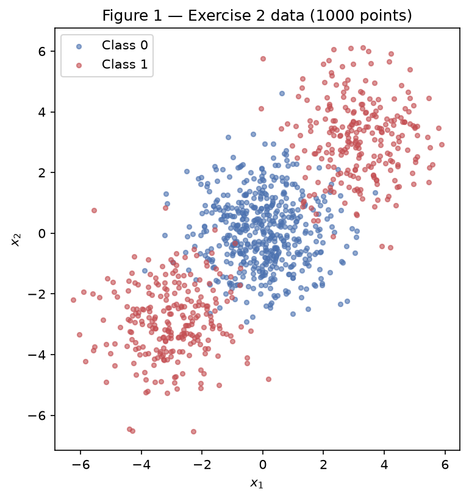
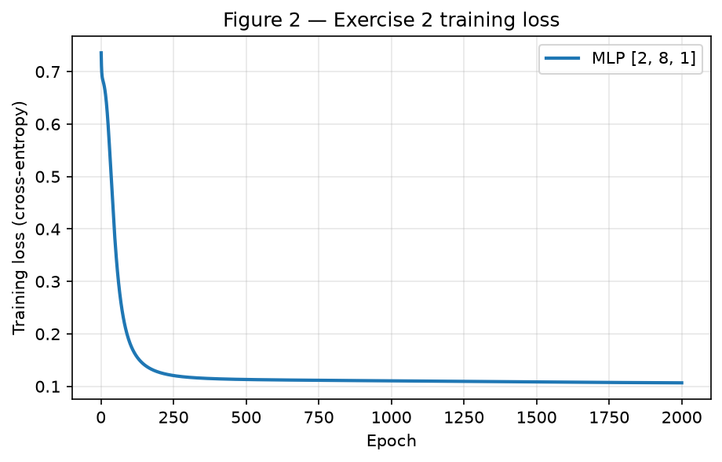
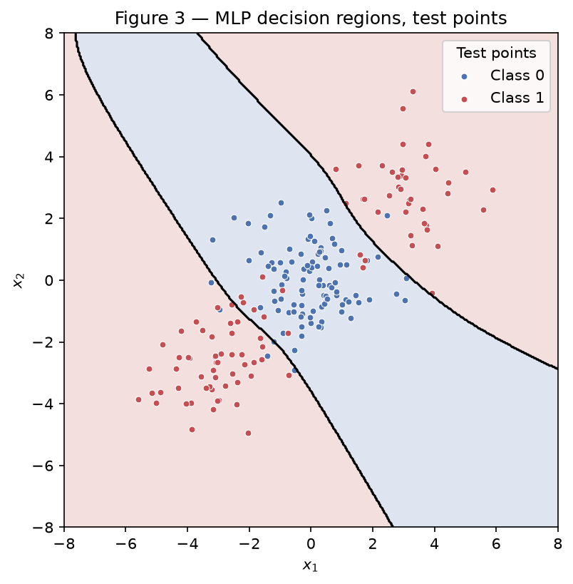
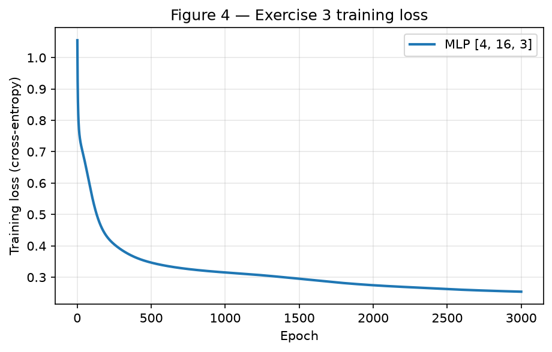
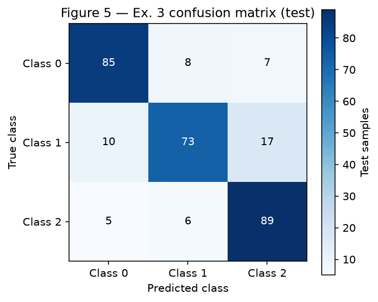
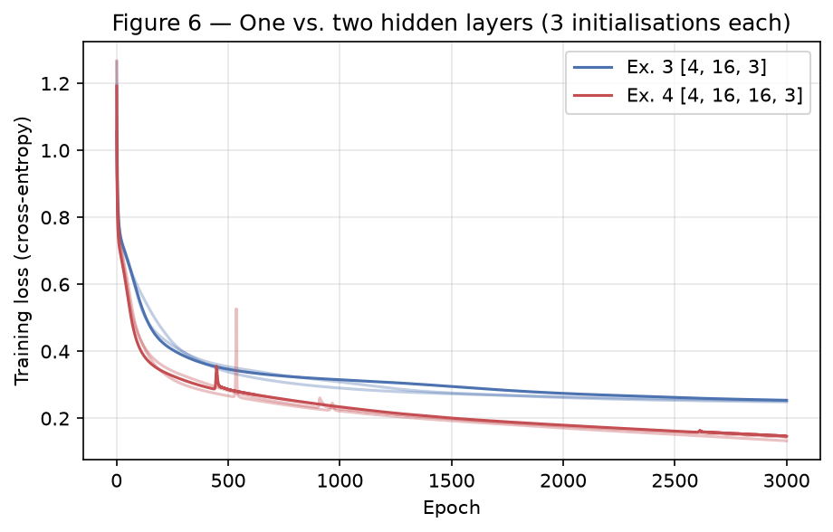

# Exercise 3 — Multi-Layer Perceptron

One hand-computed backpropagation step, then one MLP written from scratch in NumPy
and used, unchanged, for a binary problem, a three-class problem and a deeper
variant. All results use the single generator `rng = np.random.default_rng(42)`,
declared once at the top of the notebook; every weight initialisation draws from
it, in the order the cells run. The data and splits use `random_state=42` as the
statement requires.

## Exercise 1

One backpropagation step by hand. Notation from the lecture:
\(W^{(1)} \equiv W\), \(W^{(2)} \equiv V\), \(b^{(1)} \equiv b^h\),
\(b^{(2)} \equiv b^y\). Row \(i\) of \(W^{(1)}\) holds the weights of hidden
neuron \(i\), so \(z^{(1)} = W^{(1)} x + b^{(1)}\). Every value is carried at 6
decimals; \(\tanh\) is evaluated as \(\tanh(z) = (e^{2z} - 1)/(e^{2z} + 1)\).

Given: \(x = [0.5,\ -0.2]\), \(y = 1.0\),
\(W^{(1)} = \begin{bmatrix} 0.3 & -0.1 \\ 0.2 & 0.4 \end{bmatrix}\),
\(b^{(1)} = [0.1,\ -0.2]\), \(W^{(2)} = [0.5,\ -0.3]\), \(b^{(2)} = 0.2\),
\(\eta = 0.3\), \(L = (y - \hat{y})^2\).

### A — Forward pass

**Hidden pre-activations**

\[
\begin{aligned}
z^{(1)}_1 &= 0.3(0.5) + (-0.1)(-0.2) + 0.1 = 0.15 + 0.02 + 0.1 = 0.270000 \\
z^{(1)}_2 &= 0.2(0.5) + 0.4(-0.2) - 0.2 = 0.10 - 0.08 - 0.2 = -0.180000
\end{aligned}
\]

**Hidden activations**

\[
\begin{aligned}
h^{(1)}_1 &= \tanh(0.27) = \frac{e^{0.54} - 1}{e^{0.54} + 1} = \frac{0.716007}{2.716007} = 0.263625 \\
h^{(1)}_2 &= \tanh(-0.18) = \frac{e^{-0.36} - 1}{e^{-0.36} + 1} = \frac{-0.302324}{1.697676} = -0.178081
\end{aligned}
\]

**Output pre-activation, output and loss**

\[
\begin{aligned}
u^{(2)} &= 0.5(0.263625) + (-0.3)(-0.178081) + 0.2 = 0.131812 + 0.053424 + 0.2 = 0.385237 \\
\hat{y} &= \tanh(0.385237) = \frac{2.160789 - 1}{2.160789 + 1} = \frac{1.160789}{3.160789} = 0.367247 \\
L &= (1 - 0.367247)^2 = 0.632753^2 = 0.400377
\end{aligned}
\]

### B — Backward pass

The chain rule, from the loss back to the first layer. The only derivative needed
besides products is \(\tanh'(a) = 1 - \tanh^2(a)\).

**Output layer**

\[
\begin{aligned}
\frac{\partial L}{\partial \hat{y}} &= -2(y - \hat{y}) = -2(0.632753) = -1.265507 \\
\frac{\partial L}{\partial u^{(2)}} &= \frac{\partial L}{\partial \hat{y}}\,(1 - \hat{y}^2)
  = -1.265507 \times (1 - 0.134871) = -1.265507 \times 0.865130 = -1.094828 \\
\frac{\partial L}{\partial W^{(2)}} &= \frac{\partial L}{\partial u^{(2)}}\,h^{(1)}
  = -1.094828 \times [0.263625,\ -0.178081] = [-0.288624,\ 0.194968] \\
\frac{\partial L}{\partial b^{(2)}} &= \frac{\partial L}{\partial u^{(2)}} = -1.094828
\end{aligned}
\]

**Hidden layer**

\[
\begin{aligned}
\frac{\partial L}{\partial h^{(1)}} &= \frac{\partial L}{\partial u^{(2)}}\,W^{(2)}
  = -1.094828 \times [0.5,\ -0.3] = [-0.547414,\ 0.328448] \\
1 - (h^{(1)})^2 &= [1 - 0.069498,\ 1 - 0.031713] = [0.930502,\ 0.968287] \\
\frac{\partial L}{\partial z^{(1)}} &= \frac{\partial L}{\partial h^{(1)}} \odot \big(1 - (h^{(1)})^2\big)
  = [-0.547414 \times 0.930502,\ 0.328448 \times 0.968287] = [-0.509370,\ 0.318032]
\end{aligned}
\]

Each entry of \(W^{(1)}\) gets the gradient of its neuron times its input,
\(\partial L / \partial W^{(1)}_{ij} = (\partial L / \partial z^{(1)}_i)\,x_j\):

\[
\frac{\partial L}{\partial W^{(1)}} =
\begin{bmatrix}
-0.509370 \times 0.5 & -0.509370 \times (-0.2) \\
0.318032 \times 0.5 & 0.318032 \times (-0.2)
\end{bmatrix}
=
\begin{bmatrix}
-0.254685 & 0.101874 \\
0.159016 & -0.063606
\end{bmatrix},
\qquad
\frac{\partial L}{\partial b^{(1)}} = \frac{\partial L}{\partial z^{(1)}} = [-0.509370,\ 0.318032]
\]

### C — Parameter update

Every parameter moves by \(\theta \leftarrow \theta - \eta\,\partial L / \partial \theta\)
with \(\eta = 0.3\):

| Parameter | Old | \(-\eta \times\) gradient | New |
|---|---|---|---|
| \(W^{(1)}_{11}\) | 0.3 | \(-0.3 \times (-0.254685) = +0.076405\) | **0.376405** |
| \(W^{(1)}_{12}\) | −0.1 | \(-0.3 \times 0.101874 = -0.030562\) | **−0.130562** |
| \(W^{(1)}_{21}\) | 0.2 | \(-0.3 \times 0.159016 = -0.047705\) | **0.152295** |
| \(W^{(1)}_{22}\) | 0.4 | \(-0.3 \times (-0.063606) = +0.019082\) | **0.419082** |
| \(b^{(1)}_1\) | 0.1 | \(-0.3 \times (-0.509370) = +0.152811\) | **0.252811** |
| \(b^{(1)}_2\) | −0.2 | \(-0.3 \times 0.318032 = -0.095410\) | **−0.295410** |
| \(W^{(2)}_1\) | 0.5 | \(-0.3 \times (-0.288624) = +0.086587\) | **0.586587** |
| \(W^{(2)}_2\) | −0.3 | \(-0.3 \times 0.194968 = -0.058490\) | **−0.358490** |
| \(b^{(2)}\) | 0.2 | \(-0.3 \times (-1.094828) = +0.328448\) | **0.528448** |

That is every trainable number in the network, nine scalars in all: four in
\(W^{(1)}\), two in \(b^{(1)}\), two in \(W^{(2)}\) and one in \(b^{(2)}\).

**Second forward pass with the new parameters**

\[
\begin{aligned}
z^{(1)} &= [0.376405(0.5) - 0.130562(-0.2) + 0.252811,\ \ 0.152295(0.5) + 0.419082(-0.2) - 0.295410] = [0.467126,\ -0.303079] \\
h^{(1)} &= [\tanh(0.467126),\ \tanh(-0.303079)] = [1.545309 / 3.545309,\ -0.454557 / 1.545443] = [0.435874,\ -0.294127] \\
u^{(2)} &= 0.586587(0.435874) - 0.358490(-0.294127) + 0.528448 = 0.889568 \\
\hat{y} &= \tanh(0.889568) = 4.924741 / 6.924741 = 0.711181 \\
L &= (1 - 0.711181)^2 = 0.083417
\end{aligned}
\]

**The loss goes down**, from 0.400377 to 0.083417. Every parameter moved against
its own gradient, so to first order the loss changes by
\(-\eta \lVert \nabla L \rVert^2 < 0\). The sign pattern shows how: \(\hat{y}\) was
too small, \(\partial L / \partial u^{(2)} < 0\), so the update raised \(b^{(2)}\),
raised the weight on the positive hidden unit and made the weight on the negative
hidden unit more negative, all of which push \(u^{(2)}\) up. One step of size 0.3
is not guaranteed to decrease the loss (a large enough \(\eta\) can overshoot), but
here it cuts it by 79% because the step is small relative to how curved the loss is
around this point.

## Exercise 2

Binary classification that a line cannot do.

### A — Data

`make_blobs` with centres \([0,0]\), \([3,3]\), \([-3,-3]\), 500/250/250 points,
`cluster_std=1.2`, `random_state=42`. The label is \(y = (c > 0)\): the central
cluster is class 0 and the two outer ones together are class 1, 500 points each.
The 80/20 stratified split gives 800 training and 200 test points. Both feature
columns are standardised with the training-set mean and standard deviation only, so
the `tanh` units start in their responsive range.



### B — Linear baseline

`LogisticRegression` on the same standardised features reaches
**47.50% test accuracy**, below the 50% obtained by always predicting either class.
Its coefficients are \([0.073,\ 0.004]\) with an intercept of \(\approx 0\): the
fitted boundary is nearly flat, its predicted probabilities sit near 0.5
everywhere, and which side of 0.5 a point falls on is close to arbitrary.

### C — MLP from scratch

**Implementation.** The notebook defines one network used by every exercise:

- `init_layers(layer_sizes)` — the architecture is a list such as `[2, 8, 1]`,
  never hard-coded; weights are Xavier-normal (\(\mathcal{N}(0, 1/n_\text{in})\))
  drawn from the shared `rng`, biases start at zero;
- `forward(layers, X, output_activation)` — `tanh` on every hidden layer, the
  given activation on the output, returning the activations of every layer;
- `backward(layers, activations, Y)` — the gradients derived below;
- `update(layers, grads, learning_rate)` — one gradient-descent step, returning
  new layers rather than modifying the old ones;
- `train(...)` — full-batch gradient descent recording the loss every epoch.

**Derivation of the backward pass.** For a batch of \(N\) samples the loss is the
mean binary cross-entropy with \(\hat{y} = \sigma(u)\):

\[
L = -\frac{1}{N} \sum_n \big[ y_n \log \hat{y}_n + (1 - y_n) \log(1 - \hat{y}_n) \big],
\qquad \sigma'(u) = \hat{y}(1 - \hat{y})
\]

\[
\frac{\partial L}{\partial u_n}
= \frac{1}{N}\left( -\frac{y_n}{\hat{y}_n} + \frac{1 - y_n}{1 - \hat{y}_n} \right) \hat{y}_n (1 - \hat{y}_n)
= \frac{1}{N}\big( -y_n (1 - \hat{y}_n) + (1 - y_n)\hat{y}_n \big)
= \frac{\hat{y}_n - y_n}{N}
\]

Call this \(\delta^{(L)}\). With \(A^{(l)}\) the activations entering layer
\(l\) (one sample per row) and \(Z = A W + b\), each layer then needs only

\[
\frac{\partial L}{\partial W^{(l)}} = (A^{(l)})^\top \delta^{(l)}, \qquad
\frac{\partial L}{\partial b^{(l)}} = \sum_n \delta^{(l)}_n, \qquad
\delta^{(l-1)} = \big(\delta^{(l)} (W^{(l)})^\top\big) \odot \big(1 - (A^{(l)})^2\big)
\]

which is item B of Exercise 1 written for a batch and any number of layers. The
code loops over the layers from last to first applying exactly these three lines.

**Training.**

| Setting | Value |
|---|---|
| Architecture | `[2, 8, 1]`: 2 inputs, 8 `tanh` hidden units, 1 sigmoid output (33 parameters) |
| Loss | binary cross-entropy |
| Learning rate | 0.5 (full batch) |
| Epochs | 2000 |
| Training loss | 0.7359 at epoch 1 → 0.1067 at epoch 2000 |
| Test accuracy | **92.00%** |





### D — Analysis

**Why the line scores below 50%.** The class 1 points sit on both sides of class 0
along the diagonal, at \([3,3]\) and \([-3,-3]\), so the mean of class 1 is
\(\approx [0,0]\), the same as the mean of class 0. A linear classifier can only
say "the further along direction \(w\), the more likely class 1". Moving along the
diagonal towards one outer cluster means moving away from the other, so every
direction gains on one class-1 cluster exactly what it loses on the other. The
best the logistic regression can do is the near-zero weights it found, a model
that is essentially a coin flip. On 200 test points a coin flip lands within a few
points of 50%, and this one landed at 47.5%. Being below 50% is not meaningful in
itself. It shows the linear model has nothing to learn here.

**The class 1 region of Figure 3** is two disconnected pieces: one in the upper
right around \([3,3]\) and one in the lower left around \([-3,-3]\). Between them
runs a diagonal band of class 0, perpendicular to the line joining the cluster
centres and containing the origin, bounded by two roughly parallel curves.

**Why no straight line can produce it.** A line splits the plane into two
half-planes, and a half-plane is convex: if two points are in it, so is every point
on the segment between them. The centres \([3,3]\) and \([-3,-3]\) must both be in
the class 1 half-plane, so the midpoint \([0,0]\) would be too, but \([0,0]\) is
the centre of class 0. The class 1 region is not convex, so no single line, and no
single sigmoid unit, can carve it out. The hidden layer solves this by combining
several lines. Roughly, one unit fires for "beyond the upper boundary of the band",
another for "beyond the lower boundary", and the output unit fires when either
does. This produces the two boundaries visible in Figure 3. The remaining 8% of
errors are points in the overlap: with a cluster standard deviation of 1.2 and
centres only \(3\sqrt{2} \approx 4.24\) apart, some points of each outer cluster
fall inside the central one.

## Exercise 3

Multi-class classification with the same network.

### A — Data

`make_classification` with 1500 samples, 4 informative features (none redundant
or repeated), 3 classes, 2 clusters per class and `class_sep=1.0`,
`random_state=42`. The classes have 499 / 499 / 502 points; the stratified 80/20
split gives 1200 training and 300 test points. The features are standardised with
the training-set statistics, as in Exercise 2, and the targets are one-hot encoded.

### B — Adaptation: softmax and categorical cross-entropy

The output layer has 3 units with a softmax, and the loss is the categorical
cross-entropy:

\[
\hat{y}_k = \frac{e^{u_k}}{\sum_j e^{u_j}}, \qquad
L = -\frac{1}{N} \sum_n \sum_k y_{nk} \log \hat{y}_{nk}
\]

**Derivation of \(\partial L / \partial u\).** For one sample, each softmax output
depends on every \(u_j\) through the shared denominator:

\[
\frac{\partial \hat{y}_k}{\partial u_j} =
\begin{cases}
\hat{y}_k (1 - \hat{y}_k) & k = j \\
-\hat{y}_k \hat{y}_j & k \neq j
\end{cases}
\;=\; \hat{y}_k (\delta_{kj} - \hat{y}_j)
\]

\[
\frac{\partial L}{\partial u_j}
= -\sum_k \frac{y_k}{\hat{y}_k}\,\hat{y}_k (\delta_{kj} - \hat{y}_j)
= -\sum_k y_k \delta_{kj} + \hat{y}_j \sum_k y_k
= -y_j + \hat{y}_j \cdot 1
= \hat{y}_j - y_j
\]

using \(\sum_k y_k = 1\) for a one-hot target. Averaged over the batch this is
\((\hat{Y} - Y)/N\), **the same expression** as sigmoid with binary cross-entropy
in Exercise 2. In both cases the output non-linearity's derivative cancels the
loss's \(1/\hat{y}\) factor.

**Verbatim reuse (extra point).** Because the output gradient has the same form,
`forward`, `backward`, `update` and `train` are the Exercise 2 functions with no
change at all. The only differences are in the call: `layer_sizes` ends in 3
instead of 1, `output_activation=softmax` instead of `sigmoid`,
`loss=categorical_cross_entropy` instead of `binary_cross_entropy`, and the
hyper-parameters. `softmax` and `categorical_cross_entropy` are defined next to
their binary counterparts. The softmax subtracts each row's maximum before
exponentiating, which leaves the result unchanged and avoids overflow.

### C — Training

| Setting | Value |
|---|---|
| Architecture | `[4, 16, 3]`: 4 inputs, 16 `tanh` hidden units, 3 softmax outputs (131 parameters) |
| Loss | categorical cross-entropy |
| Learning rate | 0.5 (full batch) |
| Epochs | 3000 |
| Final training loss | 0.2539 |
| Test accuracy | **82.33%** |
| Logistic-regression baseline | **66.33%** |





### D — Analysis

**Most confused pair: classes 1 and 2.** In Figure 5, 17 class 1 points are
predicted as class 2 and 6 class 2 points as class 1, 23 errors between them,
against 18 for classes 0–1 and 12 for classes 0–2. Class 1 is the hardest class
overall (73% recall), and most of its losses go to class 2.

**Why, from the structure of the data.** `make_classification` places each cluster
of normally distributed points around a vertex of a 4-dimensional hypercube with
side \(2 \times \text{class\_sep} = 2\). It then applies a random linear transform
to each cluster, so the clusters are stretched and tilted. Three classes with two
clusters each fill 6 of the 16 vertices. Vertices that share an edge are only 2
units apart, about two standard deviations, so neighbouring clusters overlap. How
confused two classes are depends on how many of their clusters sit on neighbouring
vertices. The labels do not show which clusters are where, but the overlap can be
measured directly. For every training point I found its nearest other training
point in 4D and counted how often it belongs to the other class of a pair:

| Pair | Points whose nearest neighbour is the other class |
|---|---|
| 0 – 1 | 75 |
| 0 – 2 | 59 |
| **1 – 2** | **80** |

Classes 1 and 2 share the most neighbourhoods, so they are the pair with the most
mixed regions. In those regions even the best classifier must guess. The ranking
matches Figure 5.

**What the hidden layer added over the baseline.** The logistic regression scores
66.33% and its confusion matrix makes the same mistake, but much more often:

| | Pred. 0 | Pred. 1 | Pred. 2 |
|---|---|---|---|
| True 0 | 80 | 11 | 9 |
| True 1 | 11 | **57** | 32 |
| True 2 | 13 | 25 | **62** |

Each class is the union of two clusters at different vertices, so, as in
Exercise 2, a class region is generally not convex. A linear softmax gives each
class one convex region (the set where its linear score is the largest), and it
cannot cover two clusters far apart without taking in what lies between them. The
16 hidden units let the network build a non-convex region per class, one piece
around each of its clusters. That is where the gain comes from: class 1 recall
rises from 57% to 73% and class 2 from 62% to 89%. What remains is mostly the
overlap measured above, which no architecture can remove.

## Exercise 4

Does a second hidden layer help?

### A — Training

Exactly one change from Exercise 3: a second hidden layer with the same width.
Same data, same split, same learning rate (0.5), same budget (3000 full-batch
epochs), same initialisation scheme and generator.

| Setting | Value |
|---|---|
| Architecture | `[4, 16, 16, 3]`: two `tanh` hidden layers of 16 units (403 parameters) |
| Final training loss | 0.1470 |
| Test accuracy | **83.00%** |

### B — Comparison

The data and the split are fixed by `random_state=42`, so the only source of
run-to-run variation is the weight initialisation. To keep a single generator, each
"seed" is a new initialisation drawn from the shared `rng`. Run 1 of each network
is the model reported above, and runs 2 and 3 are fresh draws. Each run has the
same budget.

| Network | Hidden layers | Parameters | Final training loss (runs; mean) | Training accuracy (mean) | Test accuracy (runs; mean) |
|---|---|---|---|---|---|
| Ex. 3 `[4, 16, 3]` | 1 | 131 | 0.2539, 0.2521, 0.2490; **0.2517** | 90.83% | 82.33%, 83.33%, 83.67%; **83.11%** |
| Ex. 4 `[4, 16, 16, 3]` | 2 | 403 | 0.1470, 0.1328, 0.1446; **0.1414** | 94.75% | 83.00%, 85.00%, 84.00%; **84.00%** |

Mean test-accuracy difference (Ex. 4 − Ex. 3): **+0.89 points**. The standard
deviation across runs is 0.57 points for Ex. 3 and 0.82 for Ex. 4. One test
sample is worth 0.33 points.



### C — Analysis

**The result.** The second layer cuts the final training loss by 44% (0.252 →
0.141) and raises training accuracy by 4 points. On the test set it gains 0.89
points, which is about 3 of 300 test samples. With 3 runs per network the standard
error of the difference of the two means is
\(\sqrt{(0.57^2 + 0.82^2)/3} \approx 0.58\) points, so the gain is about 1.5
standard errors. I cannot distinguish it from no effect. The honest conclusion is that **depth did not meaningfully help
here**: the result could be a small gain or zero, and it is certainly not the 44%
improvement the training loss suggests.

**Training loss and test accuracy disagree.** The extra capacity was spent on the
training set. The train–test gap grows from 7.7 points (90.8% vs 83.1%) to 10.8
points (94.8% vs 84.0%). The deeper network is fitting the overlap region more
tightly, drawing boundaries around individual training points in places where the
classes are mixed. Those boundaries do not transfer to new points because in the
overlap the label is close to a coin flip.

**Representational benefit vs. optimisation cost.** The data is six blurred
Gaussian clusters, and the ideal boundaries between them are smooth surfaces
between neighbouring clusters. One hidden layer of 16 `tanh` units can already
place one boundary per pair of neighbouring clusters and combine them into
non-convex class regions, which is all this problem requires. A second layer
composes features of features. It can express sharper and more intricate regions,
but this data has no intricate structure to express beyond the irreducible overlap.
The cost is visible in Figure 6. The deeper network has three times as many
parameters, its gradient passes through two `tanh` derivatives, and at the same
learning rate its loss curves show sharp spikes (around epochs 450, 540 and 900)
that the one-layer curves do not. Those spikes are steps that overshoot. The deeper
network is harder to train at a learning rate the shallow one handles smoothly.
"Change one thing at a time" means I did not tune the learning rate for it. That
keeps the comparison fair, and it also means the deeper network's optimisation was
not helped.

**What data would reward depth.** Data with compositional, hierarchical structure,
where useful features are built from simpler features. Examples are images (edges →
textures → parts → objects), speech, and text. Some functions are also far cheaper
to express in depth than in width: parity of many bits, a checkerboard with many
cells, or tightly interleaved spirals. A single hidden layer can represent these
only with a number of units that grows very fast, whereas a deep network reuses
intermediate features. Six Gaussian blobs in 4D are the opposite case. Their
structure is shallow, so the extra layer adds capacity the data does not need.

## Code

```python
--8<-- "docs/exercises/mlp/code/mlp.py"
```

## Results summary

| # | Quantity | Value |
|---|---|---|
| 1 | Ex. 1 — \(z^{(1)}\) and \(h^{(1)}\) | \(z^{(1)} = [0.270000,\ -0.180000]\), \(h^{(1)} = [0.263625,\ -0.178081]\) |
| 2 | Ex. 1 — \(u^{(2)}\), \(\hat{y}\) and \(L\) | \(u^{(2)} = 0.385237\), \(\hat{y} = 0.367247\), \(L = 0.400377\) |
| 3 | Ex. 1 — updated parameters | \(W^{(1)} = \begin{bmatrix} 0.376405 & -0.130562 \\ 0.152295 & 0.419082 \end{bmatrix}\), \(b^{(1)} = [0.252811,\ -0.295410]\), \(W^{(2)} = [0.586587,\ -0.358490]\), \(b^{(2)} = 0.528448\); loss falls to 0.083417 |
| 4 | Ex. 2 — linear baseline test accuracy | 47.50% |
| 5 | Ex. 2 — architecture and test accuracy | `[2, 8, 1]` (tanh hidden, sigmoid output, η = 0.5, 2000 epochs): 92.00% |
| 6 | Ex. 3 — architecture and test accuracy | `[4, 16, 3]` (tanh hidden, softmax output, η = 0.5, 3000 epochs): 82.33% (baseline 66.33%) |
| 7 | Ex. 3 — most-confused class pair | Classes 1 and 2 (17 + 6 = 23 test errors) |
| 8 | Ex. 4 — architecture and test accuracy | `[4, 16, 16, 3]`: 83.00% |
| 9 | Ex. 4 — accuracy difference vs. Ex. 3 (mean of 3 initialisations) | +0.89 points (84.00% vs 83.11%), within run-to-run noise |
